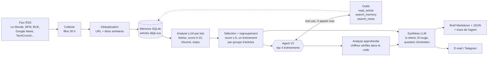

# Agent de veille économique : marchés, banques, IA

Chaque matin à 7h45 (heure de Paris, week-end compris), cet agent lit une quinzaine de flux d'actualité, élimine les doublons et le bruit, demande à un LLM (Claude) de noter et résumer chaque article, puis rédige un brief : les 3 informations à retenir, un fil rouge entre les actualités et une question d'entretien possible. Le brief est enregistré dans `briefs/` et peut être envoyé par e-mail ou sur Telegram.

**Nouveauté V2 : un vrai agent.** Pour les événements les mieux notés, le modèle décide lui-même quoi faire : lire l'article en entier, chercher dans la mémoire ce qui s'est passé les jours précédents, lancer une recherche complémentaire, puis rendre une analyse approfondie (chiffres clés vérifiés, contexte, « ce qui change depuis hier »). Chaque raisonnement est tracé dans `briefs/AAAA-MM-JJ.trace.json`.

Projet personnel d'Alexandre Melaïmi (INSA Lyon, génie mécanique), conçu pour les membres de l'association INSA Finance.

## Architecture



### Pipeline ou agent ?

- **Le pipeline (V1)** suit toujours les mêmes étapes, dans le même ordre : collecter, noter, résumer, rédiger. C'est prévisible, peu coûteux, mais le modèle ne voit que le titre et l'extrait RSS.
- **L'agent (V2)** reçoit un objectif (« approfondis cet événement ») et des outils. À chaque tour, **c'est lui qui choisit** : lire un article, comparer avec la mémoire, chercher ailleurs, ou conclure. Le code se contente d'exécuter les outils demandés, de renvoyer les résultats et de faire respecter un budget. Si l'agent échoue, l'événement garde son résumé V1 : le pipeline sert de filet de sécurité.

| Fichier | Rôle |
|---|---|
| `config.yaml` | Thèmes, flux, profil du lecteur, seuils, réglages de l'agent. Tout se règle ici sans toucher au code. |
| `veille/collect.py` | Téléchargement des flux, nettoyage, filtre de date, déduplication. |
| `veille/llm.py` | Appel à l'API Claude : sortie JSON structurée (pipeline), tours avec outils (agent), comptage des tokens séparé. |
| `veille/analyze.py` | Classement, notation et résumé des articles par lots. |
| `veille/agent.py` | **V2.** Boucle de tool use, budget, vérification des chiffres, trace. |
| `veille/tools.py` | **V2.** Les outils : lecture d'article, décodage des liens Google News, recherche d'actualité. |
| `veille/brief.py` | Sélection, regroupement par événement, synthèse et mise en forme. |
| `veille/memory.py` | Base SQLite des articles vus et analysés, avec recherche pour l'agent. |
| `main.py` | Orchestration de bout en bout. |

## Choix techniques

- **Sortie structurée par outil forcé.** Le modèle répond via un outil au schéma JSON strict plutôt qu'en texte libre. Pas de parsing fragile, et les réponses incohérentes (index inexistant, thème inconnu) sont filtrées.
- **Traitement par lots.** 15 articles par appel au lieu d'un appel par article : beaucoup moins de tokens répétés pour le prompt système.
- **Robustesse.** Un flux en panne ou un lot raté est journalisé puis ignoré ; le brief sort quand même.
- **Garde-fous contre les hallucinations.** Le prompt interdit d'inventer, la synthèse ne s'appuie que sur les articles retenus, et chaque résumé renvoie vers sa source.
- **Coût suivi.** Chaque brief affiche le nombre d'appels et de tokens consommés, avec la part de l'agent comptée à part.
- **Boucle de tool use écrite à la main.** Appels directs à l'API Messages, sans framework : le modèle demande des outils (`stop_reason == "tool_use"`), le code les exécute et renvoie les `tool_result`, jusqu'à l'appel de l'outil final `submit_analysis`. On maîtrise chaque étape avant d'ajouter LangChain ou un SDK d'agents.
- **Budget et sortie garantie.** 5 appels d'outils au plus par événement. Le budget atteint, l'appel à `submit_analysis` est forcé (`tool_choice`), et un plafond absolu d'appels au modèle garantit que la boucle se termine toujours.
- **Les pages web sont des données, pas des ordres.** Le texte d'un article est encadré par des balises `<document>`, le modèle a pour consigne d'en ignorer toute instruction, une balise de fermeture glissée dans la page est neutralisée, et l'agent ne peut ouvrir que les liens fournis ou renvoyés par sa recherche (jamais une adresse arbitraire).
- **Chiffres vérifiés dans le code.** Chaque chiffre clé annoncé par le modèle doit apparaître dans le texte d'un article réellement lu (les écritures `1,5`, `1.5` et `1 500` sont reconnues) ; sinon il est supprimé et noté dans la trace. On ne se contente pas de demander au modèle de ne pas inventer.
- **Échecs absorbés.** Site payant, erreur 403, délai dépassé : l'outil renvoie un échec que le modèle peut contourner (autre lien, recherche). Sans aucune source lisible, l'événement garde son résumé V1. Une erreur de clé ou de crédits (400, 401, 403) arrête seulement l'agent : le brief V1, déjà payé, est écrit.

- **Texte parasite réparé.** Il arrive que le modèle recopie un paramètre de l'outil (`<parameter name="key_figures">[...]`) dans un champ texte. Le code coupe ce texte et récupère les chiffres qui s'y trouvaient, qui passent ensuite par la même vérification que les autres.

## Optimisation du coût (v2.2)

Tarif de `claude-haiku-5-5` : 0,10 $ par million de tokens en entrée, 0,50 $ en sortie. Le cache est compté à 1,25 x l'entrée à l'écriture et 0,1 x à la lecture (barème standard, non confirmé pour ce modèle). Le coût affiché dans le brief est une estimation calculée à partir des tokens que l'API renvoie.

| Choix | Pourquoi |
|---|---|
| **Prompt caching** sur le système + outils et sur l'historique de l'agent | Chaque tour de l'agent renvoie tout l'historique, articles compris : 85 % des tokens d'entrée venaient de là. Le préfixe commun aux événements est aussi réutilisé. |
| **2 articles lus au plus par événement**, 5 appels d'outils (au lieu de 6) | Le texte lu est renvoyé à chaque tour : un 3e article coûte cher pour peu d'information. |
| **Domaine refusé mémorisé** | Un site qui répond 403 n'est pas retéléchargé pendant l'analyse du même événement. Les liens Google News sont décodés avant, pour connaître le vrai site. |
| **4 500 caractères par article** (au lieu de 6 000) | Le début d'un article contient l'essentiel. Les analyses gardent 0 à 4 chiffres vérifiés, comme avant ; l'échantillon (4 à 5 événements) est trop petit pour mesurer un effet plus fin. |
| **4 événements approfondis** (au lieu de 5) | Choix de l'auteur pour réduire le coût de l'agent d'environ 20 %. |
| **Effort `low`** pour le tri et la notation, `medium` pour l'agent | Tâches à schéma strict. Test A/B sur 30 articles : l'écart de notes entre `low` et le défaut (0,29 à 0,47 point) est du même ordre que l'écart entre deux runs identiques (0,38 à 0,39) ; thèmes identiques. |

**Mesure avant / après** (`python main.py --limit 30 --no-memory`, mêmes flux le même jour) :

| | Avant (v2.1) | Après (v2.2) |
|---|---|---|
| Événements approfondis | 5 | 4 |
| Appels au modèle | 17 | 17 |
| Tokens lus (cache compris) | 89 447 | 88 888 (dont 43 227 relus depuis le cache) |
| Tokens produits (sortie) | 17 948 | 14 680 |
| **Coût estimé** | **≈ 0,018 $** | **≈ 0,013 $ (-26 %)** |
| Coût de l'agent par événement | ≈ 0,0027 $ | ≈ 0,0023 $ (-14 %) |
| Durée | 162 s | 124 s |
| Articles lus / lectures refusées (403) | 7 / 4 | 5 / 1 |

Lecture honnête : sur 30 articles, la moitié de l'économie vient du 4e événement supprimé. Le cache ne réduit le coût par événement que de 14 %, car chaque nouveau morceau d'historique est d'abord écrit dans le cache (1,25 x) avant d'être relu (0,1 x). L'économie principale est donc le plafond de lectures, pas le cache.

**Coût d'un brief complet** (≈ 210 articles collectés, 158 analysés, 4 analyses approfondies) : environ **0,03 $** et 4 à 5 minutes, dont 0,022 $ pour le pipeline (surtout les tokens de sortie des résumés) et 0,009 $ pour l'agent, soit environ 1 $ par mois.

## Installation

```bash
git clone https://github.com/Alexjudoue/Veille-ia.git
cd Veille-ia
python -m venv .venv
source .venv/bin/activate        # Windows : .venv\Scripts\activate
pip install -r requirements.txt
echo "ANTHROPIC_API_KEY=ta-clé" > .env    # crée le fichier .env avec ta clé API
```

Pour l'envoi par e-mail ou Telegram, ajoute aussi les variables correspondantes dans `.env` (voir `.env.example` et plus bas). Le fichier `.env` n'est jamais publié.

La clé API se crée sur [console.anthropic.com](https://console.anthropic.com).

## Utilisation

```bash
python main.py --dry-run --no-memory   # liste les articles collectés, sans appel au LLM (gratuit)
python main.py --limit 15              # premier vrai test, limité à 15 articles
python main.py                         # brief complet -> briefs/AAAA-MM-JJ.md (+ .trace.json)
python main.py --no-agent              # comportement V1 : sans approfondissement, moins cher
python main.py --email                 # + envoi par e-mail
python main.py --test-email            # renvoie le dernier brief par e-mail, sans LLM (gratuit)
python main.py --send                  # + envoi Telegram
pytest                                 # tests, sans réseau ni clé
```

## Envoi par e-mail (optionnel)

Le brief part en HTML mis en forme (lisible sur téléphone), avec une version texte en secours. L'envoi passe par le serveur SMTP de Gmail, sans service tiers.

1. Active la [validation en deux étapes](https://myaccount.google.com/signinoptions/two-step-verification) sur ton compte Google.
2. Crée un [mot de passe d'application](https://myaccount.google.com/apppasswords) (code de 16 lettres, révocable à tout moment). Ce n'est pas ton mot de passe Google.
3. Dans `.env`, renseigne `EMAIL_SENDER` (ton adresse Gmail) et `EMAIL_APP_PASSWORD`. `EMAIL_TO` est optionnel : vide, le brief t'est envoyé ; plusieurs adresses séparées par des virgules partent en copie cachée.
4. Teste avec `python main.py --test-email`.

## Envoi sur Telegram (optionnel)

1. Sur Telegram, écris à `@BotFather`, envoie `/newbot` et récupère le token.
2. Crée un groupe ou un canal, ajoute le bot, puis envoie un message.
3. Ouvre `https://api.telegram.org/bot<TOKEN>/getUpdates` et note le `chat.id`.
4. Renseigne `TELEGRAM_BOT_TOKEN` et `TELEGRAM_CHAT_ID` dans `.env`.

## Automatisation avec GitHub Actions

Le workflow `.github/workflows/veille.yml` génère le brief **tous les jours à 7h45, heure de Paris**, l'envoie par e-mail, puis enregistre le brief et la mémoire dans le dépôt.

**Pourquoi deux crons et une garde.** Le cron de GitHub est en UTC, et Paris passe de UTC+2 (été) à UTC+1 (hiver). Un seul cron serait faux la moitié de l'année. Le workflow programme donc les deux horaires, `45 5` et `45 6` (UTC), et un premier job « garde » décide lequel doit s'exécuter :

- il lit l'heure à Paris (`TZ=Europe/Paris`) ; avant 7h, c'est le mauvais cron (le cron d'été tombe à 6h45 l'hiver) : on passe ;
- si le brief du jour existe déjà dans `briefs/`, l'autre cron ou un lancement manuel est déjà passé : on passe, **pas de double envoi** ;
- sinon on exécute.

Résultat : une seule exécution utile par jour, au changement d'heure (25 octobre, puis fin mars) comme le reste de l'année, sans rien modifier à la main. Cette garde teste « après 7h et pas encore de brief » plutôt que « exactement 7h45 » : GitHub retarde parfois les crons de plusieurs minutes, et un retard ne fait pas perdre le brief du jour. En heure d'été, si la première exécution échoue avant d'écrire le brief, le second cron (8h45) réessaie ; en hiver, une seule exécution est utile et il n'y a pas de réessai automatique.

**Mise en place**

1. Pousse le projet sur GitHub.
2. Dans *Settings > Secrets and variables > Actions > New repository secret*, crée : `ANTHROPIC_API_KEY`, `EMAIL_SENDER` (ton adresse Gmail), `EMAIL_APP_PASSWORD` (le mot de passe d'application de 16 lettres) et `EMAIL_TO` (le destinataire ; plusieurs adresses séparées par des virgules partent en copie cachée). Les deux secrets Telegram restent optionnels.
3. Dans l'onglet *Actions > Veille quotidienne > Run workflow*, lance une exécution à la main pour vérifier. Case *force* cochée : le brief est regénéré même si les articles ont déjà été vus (`--no-memory`).

**À savoir.** Un e-mail qui ne part pas fait échouer l'exécution (GitHub t'envoie alors sa propre alerte) ; le brief et la mémoire sont tout de même sauvegardés. Un lancement manuel ignore la garde : il peut donc produire un second e-mail dans la journée.

## Feuille de route

- [x] **V1, pipeline** : collecte, analyse, synthèse, mémoire, envoi, exécution quotidienne.
- [x] **V2, agent** : boucle de tool use (`read_article`, `search_memory`, `search_news`, `submit_analysis`), budget, chiffres vérifiés, trace de chaque raisonnement, coût de l'agent suivi à part.
- [x] **Envoi par e-mail** : brief HTML via Gmail, destinataires multiples en copie cachée.
- [x] **V2.2, coût et automatisation** : prompt caching, lectures plafonnées, coût estimé dans chaque brief, envoi quotidien à 7h45 heure de Paris toute l'année.
- [ ] **V3, évaluation** : jeu d'articles annotés à la main pour mesurer la qualité du score de pertinence et des analyses de l'agent, suivi du coût et des retours des lecteurs.

## Limites connues

- **Seuls les événements approfondis sont lus en entier** (4 par jour par défaut). Les autres résumés s'appuient toujours sur le titre et l'extrait RSS, souvent vide pour Google News.
- **Beaucoup de sites ne se laissent pas lire** (paywall, accès refusé : environ la moitié des liens testés). L'agent essaie alors un autre lien du même événement ou une recherche ; à défaut, l'événement garde son résumé V1.
- **Le décodage des liens Google News repose sur un service interne non documenté.** Il fonctionne aujourd'hui, mais Google peut le modifier : l'agent le traite alors comme un échec d'outil.
- **La vérification des chiffres est volontairement simple** : elle contrôle qu'un nombre apparaît dans le texte lu, pas qu'il est associé au bon sujet. Un chiffre écrit en toutes lettres (« quatre milliards ») n'est pas reconnu et sera écarté.
- **Pas de température réglable.** Le modèle par défaut (`claude-haiku-5-5`) n'accepte pas d'autre température que la sienne ; la fiabilité vient des schémas stricts et des vérifications dans le code.
- Les flux RSS changent parfois d'adresse : un flux cassé est ignoré, il suffit de le remplacer dans `config.yaml`.
- Contenu généré par IA : les chiffres doivent être vérifiés dans la source avant d'être réutilisés.
