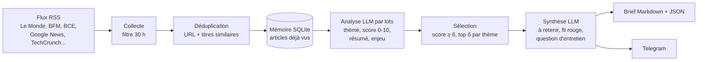

# Agent de veille économique : marchés, banques, IA

Chaque matin en semaine, cet agent lit une quinzaine de flux d'actualité, élimine les doublons et le bruit, demande à un LLM (Claude) de noter et résumer chaque article, puis rédige un brief : les 3 informations à retenir, un fil rouge entre les actualités et une question d'entretien possible. Le brief est enregistré dans `briefs/` et peut être envoyé sur Telegram.

Projet personnel d'Alexandre Melaïmi (INSA Lyon, génie mécanique), conçu pour les membres de l'association INSA Finance.

## Architecture



| Fichier | Rôle |
|---|---|
| `config.yaml` | Thèmes, flux, profil du lecteur, seuils. Tout se règle ici sans toucher au code. |
| `veille/collect.py` | Téléchargement des flux, nettoyage, filtre de date, déduplication. |
| `veille/llm.py` | Appel à l'API Claude avec sortie JSON structurée et comptage des tokens. |
| `veille/analyze.py` | Classement, notation et résumé des articles par lots. |
| `veille/brief.py` | Sélection des meilleurs articles, synthèse et mise en forme. |
| `veille/memory.py` | Base SQLite des articles vus et analysés. |
| `main.py` | Orchestration de bout en bout. |

## Choix techniques

- **Sortie structurée par outil forcé.** Le modèle répond via un outil au schéma JSON strict plutôt qu'en texte libre. Pas de parsing fragile, et les réponses incohérentes (index inexistant, thème inconnu) sont filtrées.
- **Traitement par lots.** 15 articles par appel au lieu d'un appel par article : beaucoup moins de tokens répétés pour le prompt système.
- **Robustesse.** Un flux en panne ou un lot raté est journalisé puis ignoré ; le brief sort quand même.
- **Garde-fous contre les hallucinations.** Le prompt interdit d'inventer, la synthèse ne s'appuie que sur les articles retenus, et chaque résumé renvoie vers sa source.
- **Coût suivi.** Chaque brief affiche le nombre d'appels et de tokens consommés.
- **Pas de framework.** Appels directs à l'API, pour maîtriser chaque étape avant d'ajouter LangChain ou un SDK d'agents.

## Installation

```bash
git clone https://github.com/<
Alexjudoue>/veille-ia.git
cd veille-ia
python -m venv .venv
source .venv/bin/activate        # Windows : .venv\Scripts\activate
pip install -r requirements.txt
cp .env.example .env             # puis colle ta clé API dans .env
```

La clé API se crée sur [console.anthropic.com](https://console.anthropic.com).

## Utilisation

```bash
python main.py --dry-run --no-memory   # liste les articles collectés, sans appel au LLM (gratuit)
python main.py --limit 15              # premier vrai test, limité à 15 articles
python main.py                         # brief complet -> briefs/AAAA-MM-JJ.md
python main.py --send                  # + envoi Telegram
pytest                                 # tests, sans réseau ni clé
```

## Envoi sur Telegram (optionnel)

1. Sur Telegram, écris à `@BotFather`, envoie `/newbot` et récupère le token.
2. Crée un groupe ou un canal, ajoute le bot, puis envoie un message.
3. Ouvre `https://api.telegram.org/bot<TOKEN>/getUpdates` et note le `chat.id`.
4. Renseigne `TELEGRAM_BOT_TOKEN` et `TELEGRAM_CHAT_ID` dans `.env`.

## Automatisation avec GitHub Actions

Le workflow `.github/workflows/veille.yml` lance la veille du lundi au vendredi à 5h45 UTC, puis enregistre le brief et la mémoire dans le dépôt.

1. Pousse le projet sur GitHub.
2. Dans *Settings > Secrets and variables > Actions*, ajoute `ANTHROPIC_API_KEY` (et les deux secrets Telegram si besoin).
3. Dans l'onglet *Actions*, lance le workflow à la main avec *Run workflow* pour vérifier.

## Feuille de route

- [x] **V1, pipeline** : collecte, analyse, synthèse, mémoire, envoi, exécution quotidienne.
- [ ] **V2, agent** : le LLM dispose d'outils (`search_web`, `read_article`, `query_memory`) et décide lui-même quels sujets approfondir, en lisant l'article complet et en le reliant aux jours précédents.
- [ ] **V3, évaluation** : jeu d'articles annotés à la main pour mesurer la qualité du score de pertinence, détection des chiffres inventés dans les résumés, suivi du coût et des retours des lecteurs.

## Limites connues

- Les résumés s'appuient sur le titre et l'extrait RSS, pas sur l'article entier (prévu en V2).
- Les flux RSS changent parfois d'adresse : un flux cassé est ignoré, il suffit de le remplacer dans `config.yaml`.
- Contenu généré par IA : les chiffres doivent être vérifiés dans la source avant d'être réutilisés.
